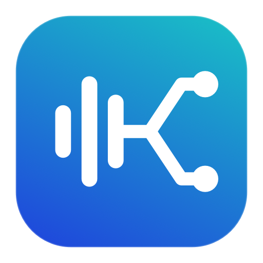

<p align="center">
  
</p>

# Audio Router

Send each Mac app's audio to the output you want.

Play **Brave through your Mac speakers** and **Chrome through your headphones** at the same time. Audio Router lives in your menu bar.

## Run

You need **macOS 14.4 or newer**, [Rust](https://rustup.rs/), and Apple's command-line tools. You don't need to open Xcode or install an audio driver.

```sh
git clone https://github.com/skmail/audio-router.git
cd audio-router
cargo run
```

The app icon appears in your menu bar. There is no main window or Dock icon.

## Use it

1. Play audio in an app.
2. Click Audio Router in the menu bar.
3. Hover over an output, such as **MacBook Pro Speakers** or your headphones.
4. Click the app you want to send there.

A checkmark means the app is assigned to that output. Click it again to remove the assignment. Select it under another output to move it there.

Your choices are saved. Chrome and Brave each appear as one app, including their helper processes. All tabs in the same browser use the same output.

**Options** contains pause, retry, and reset controls. Quitting Audio Router restores normal playback.

## Permission

macOS needs permission to capture an app's audio before it can be routed. Allow the audio-recording prompt when it appears.

If routing fails, open **System Settings → Privacy & Security → Screen & System Audio Recording** and enable Audio Router. Restart the app, then choose **Options → Refresh / retry routes**.

Audio Router does not save your audio or send it over the internet.

## Build a standalone app

```sh
./build.sh
```

Open `dist/Audio Router.app`, or drag it into Applications. You won't need a terminal to launch it after that.

For an optimized build directly from Cargo:

```sh
cargo run --release
```

## Things to know

- If headphones disconnect, the app returns to its normal output. **Sound may come from your speakers.** The saved route returns when the headphones reconnect.
- New apps and device changes are picked up about every two seconds.
- This version routes stereo audio. Mono outputs are supported; extra surround channels are left silent.
- Bluetooth devices still have their usual audio delay. Some protected media may not allow capture.
- Local builds are signed without a paid developer account. After rebuilding, macOS may ask for permission again. Shared releases need separate signing and notarization.

## Development

Written in Rust, using AppKit for the menu and Core Audio process taps for routing. Each assigned app gets its own private route to an output. The system's default output is left alone.

```sh
cargo test --locked
cargo clippy --locked -- -D warnings
cargo run -- --list
```

The last command lists outputs and audio apps without capturing audio.

Icon assets are included in the repository. To regenerate them:

```sh
swift -module-cache-path target/swift-cache scripts/generate-icons.swift
iconutil -c icns target/AppIcon.iconset -o resources/AppIcon.icns
```

For the capture API, see [Apple's Core Audio taps documentation](https://developer.apple.com/documentation/coreaudio/capturing-system-audio-with-core-audio-taps).
